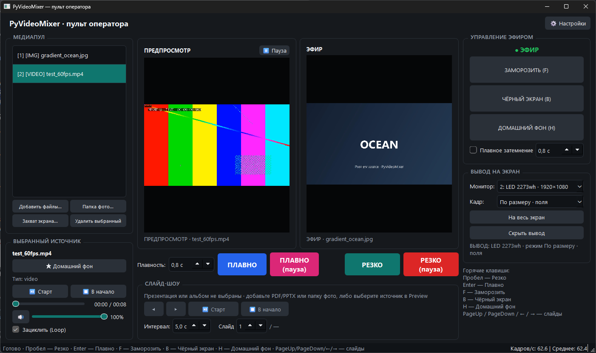
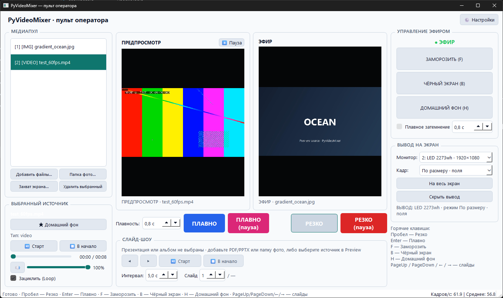

# PyVideoMixer v1.7

Лёгкий операторский видеомикшер для Windows для проведения мероприятий, презентаций, концертов и трансляций с выводом на проектор или второй монитор.


## Возможности

- Двухмониторная архитектура с отдельными окнами `ПРЕДПРОСМОТР` и `ЭФИР`. Окно пульта автоматически защищено от перекрытия выводом на рабочий монитор.
- Переходы `РЕЗКО`, `РЕЗКО (пауза)`, `ПЛАВНО` и `ПЛАВНО (пауза)` с настраиваемой длительностью.
- Мягкое 50-мс затухание звука перед остановкой видео без щелчков и автоматический сброс роликов в `00:00`.
- Работа с презентациями `PPTX`, `PDF` и альбомами фотографий.
- Автоматический предпросмотр следующего слайда в окне `ПРЕДПРОСМОТР`.
- Настраиваемые клавиши USB-кликера для перехода вперёд и назад по слайдам.
- Эфирные мастер-кнопки: `ЗАМОРОЗИТЬ (F)`, `ЧЁРНЫЙ ЭКРАН (B)` с плавным затуханием и `ДОМАШНИЙ ФОН (H)`.
- Захват любого окна Windows или второго экрана через `dxcam` и `mss`.
- Кастомизация дизайна: темы `Тёмная`, `Светлая` и `Системная`, собственный HEX/RGB-акцент и индивидуальные цвета для всех четырёх кнопок переходов.

## Скриншоты интерфейса

Скриншоты пульта в двух цветовых темах:

| Тема пульта | Скриншот |
|---|---|
| Тёмная тема |  |
| Светлая тема |  |

## Технологический стек и рендеринг

### GUI и композитинг

- **PySide6 (Qt 6)** — графический интерфейс, окна вывода и композитинг.
- Многопоточная загрузка источников, чтобы подготовка материалов не блокировала операторский пульт.

### Воспроизведение видео

Для видео FullHD и 4K используется аппаратный конвейер **Qt Multimedia**: `QMediaPlayer` совместно с `QVideoWidget` / `QVideoSink`. Декодирование выполняется через системные кодеки Windows Media Foundation и DirectShow. При отсутствии активного движения в эфире применяется адаптивное снижение фоновой нагрузки на CPU.

### Презентации и документы

- **PyMuPDF (`fitz`)** — чтение и рендеринг PDF.
- Конвертация `PPTX → PDF` через Microsoft PowerPoint COM или LibreOffice.

### Захват экрана и окон

- **dxcam** — захват через Desktop Duplication API.
- Автоматический фолбэк на **mss**.
- Захват отдельных окон через Win32 `PrintWindow`.

## Системные требования

- **Операционная система:** Windows 10 или Windows 11, x64.
- **Минимальное оборудование:** 2-ядерный процессор Intel Core i3 / AMD A9 или выше, от 4 ГБ ОЗУ, видеокарта с поддержкой DirectX 11.
- **Запуск из исходников:** Python `3.10+`, включая версии `3.10–3.14`.
- **Готовая сборка:** для запуска версии из раздела Releases установка Python не требуется.

Для стабильной работы с видео 4K и несколькими источниками рекомендуется более производительный процессор, 8 ГБ ОЗУ или больше и современная видеокарта.

## Быстрый старт

### Вариант 1: готовая portable-сборка

1. Откройте раздел **[Releases](../../releases)**.
2. Скачайте архив `PyVideoMixer-v1.7-win64.zip`.
3. Распакуйте архив в удобную папку.
4. Запустите `PyVideoMixer.exe`.

### Вариант 2: запуск из исходников

Установите зависимости и запустите приложение:

```powershell
pip install -r requirements.txt
python main.py
```

Для работы с презентациями `PPTX` может потребоваться установленный Microsoft PowerPoint или LibreOffice.

### Сборка `.exe`

```powershell
python build_exe.py
```

## Горячие клавиши

| Операция | Клавиша |
|---|---|
| `РЕЗКО` | `Space` |
| `ПЛАВНО` | `Enter` |
| `ЗАМОРОЗИТЬ` | `F` |
| `ЧЁРНЫЙ ЭКРАН` | `B` |
| Следующий слайд | настраивается в `Настройки` |
| Предыдущий слайд | настраивается в `Настройки` |

## Структура проекта

- [`main.py`](main.py) — запуск приложения.
- [`core/`](core/) — основная логика, композитинг и служебные компоненты.
- [`sources/`](sources/) — источники медиаданных.
- [`ui/`](ui/) — интерфейс оператора и окна вывода.
- [`docs/`](docs/) — документация и скриншоты.
- [`build.spec`](build.spec) и [`build_exe.py`](build_exe.py) — конфигурация и сценарий сборки Windows-версии.

## О разработке и поддержка проекта

Весь программный код проекта написан с помощью ИИ-ассистентов. Автор проекта выступал в роли менеджера: проектировал логику пульта, ставил задачи, находил и исправлял ошибки, а также обкатывал программу на реальных школьных мероприятиях.

[](https://donationalerts.com__)
